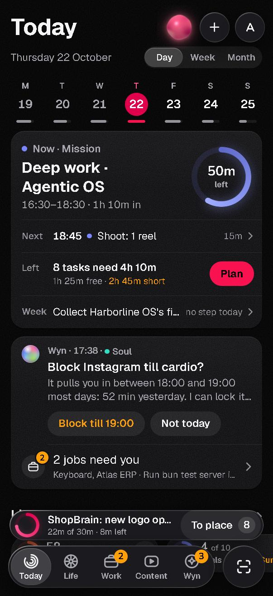
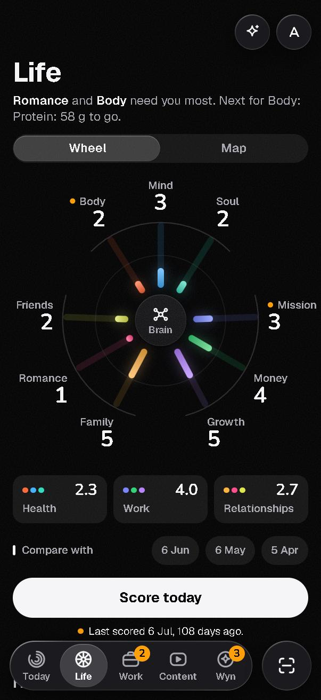
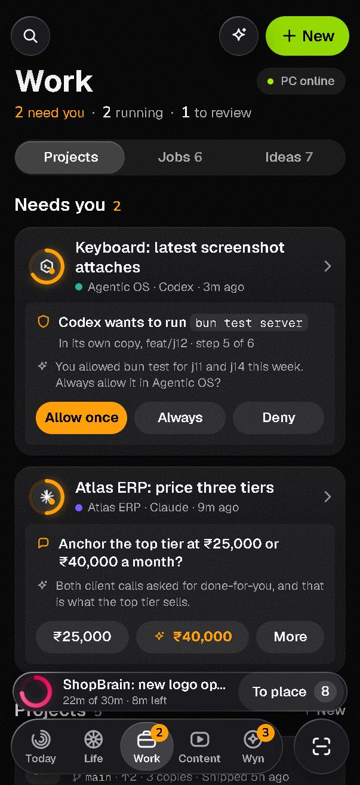
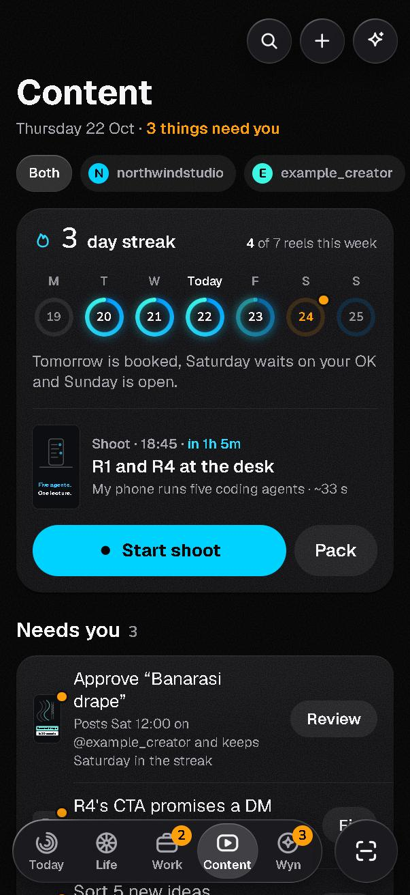
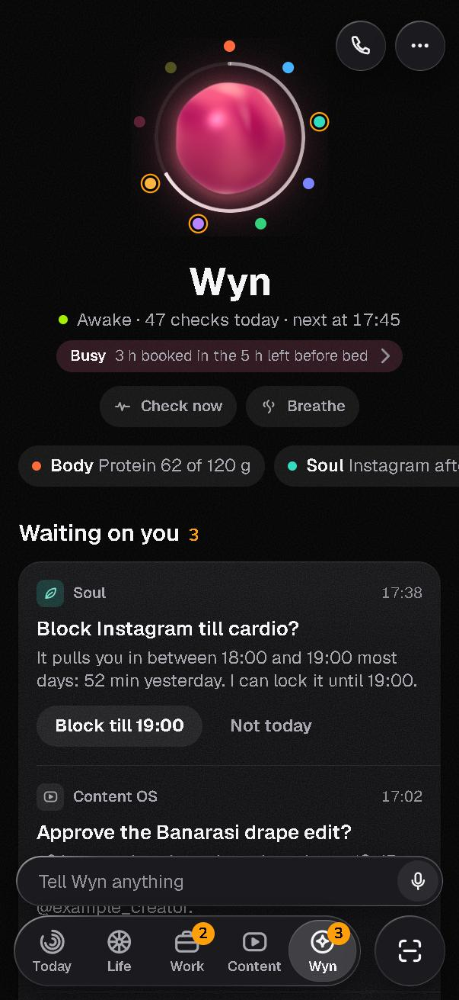

<h1 align="center">Agentic OS</h1>

<p align="center">
A phone-first operating system for your life and your work, running on your own PC.<br>
Plan the day, track the nine areas of your life, and run Claude Code and Codex jobs from your phone, with an assistant called Wyn keeping watch.
</p>

<p align="center">
<a href="../../releases/latest"><b>Download the Android APK or iOS IPA</b></a> ·
<a href="#quick-start">Quick start</a> ·
<a href="docs/SETUP.md">Full setup</a> ·
<a href="docs/ARCHITECTURE.md">How it works</a>
</p>

<p align="center">





</p>

<p align="center"><sub>Screenshots use the built-in demo data (fictional people and numbers).</sub></p>

---

## What it is

Agentic OS has three parts:

1. **The phone app** (Android and iPhone, built with Capacitor). This is where you use it.
2. **A small server on your PC** (Bun + SQLite). It stores your data, runs the AI agents, and answers the app.
3. **`agentos`, a command-line tool** that owns the database schema. The server, the app and any AI agent on your PC all read and write through it.

Your data stays in SQLite files on your PC. The only outside calls go to services you configure yourself, such as Claude Code, Codex, OpenAI or Google Calendar.

## Features

### Today
- A timeline of your day built from your calendar, with a **Now / Next** card and how much of the current block is left.
- **Plan** fits your open tasks into the free time you have left and tells you when the day is overbooked.
- Day, week and month views, drag to reschedule, and a night review that closes the day.

### Life: nine areas around a Brain
Score each area, see which ones need you most, and compare with past months. Each area is a small app of its own:

| Area | What it does |
|---|---|
| **Body** | Training plans, an exercise library with pictures, food and protein log, recovery. Reads Apple Health on iPhone. |
| **Mind** | Daily check-in, courses with a saved resume point, reading list, and which apps eat your time. |
| **Soul** | Screen-time nudges ("Block Instagram till cardio?") and a focus blocker. |
| **Mission** | Goals and the weekly step that moves each one. |
| **Money** | Logs payments from UPI/bank messages, imports PDF statements with a review step, budgets with a daily allowance, accounts and cards. |
| **Growth** | A journal with photos and the streaks that feed each area. |
| **Family · Romance · Friends** | People, how often you want to see them, dates, moments and ideas. |

The **Brain** in the middle holds your notes, with search, a graph view and an optional lock.

### Work: Claude Code and Codex from your phone
- Start a job on any project folder on your PC and pick **Claude Code** or **Codex**. Both run on your existing sign-in, no API key needed.
- Each job is a live chat with plan mode, progress bars, and a question form when the agent needs a decision.
- When an agent wants to run a command you get an **Allow once / Always / Deny** card on your phone.
- Every job runs in its own git worktree and is checkpointed before and after each turn, so you can see the diff and revert.
- Projects, a jobs list, and an ideas inbox the agents can add to.

### Content OS
- Channels, a posting streak, shoot plans with a script, takes, and an approval step before anything is posted.
- Transcribes reels and videos for research (yt-dlp + OpenAI transcription).

### Scan and capture
One camera button for a receipt, a screenshot, a note or a business card. The app decides where it belongs (Money, People, Brain…) and files it. The share sheet works the same way.

### Wyn, the assistant
- Chat or talk to Wyn. She can use the tools of every area: add a task, log food, move a block, start a job.
- She acts on her own only on small things you can undo, and asks before money goes out, before contacting someone new, before deleting, and before anything that can't be undone.
- Regular checks through the day, with suggestions waiting on the Wyn tab.
- Optional: a WhatsApp bridge, phone calls with voice, and a Claude Code plugin that lets Wyn hand a prompt to a Claude session running on your PC and bring back its reply.

### Also in the box
- **Accounts:** one owner plus members you invite with a code. Each member gets their own database.
- **Offline-first:** the app keeps a local copy and syncs. Writes are safe to retry, so nothing is applied twice.
- **iPhone extras:** home-screen widgets, a Live Activity for the current block, a share extension and Face ID lock.
- **Modules:** clients/CRM, pricing, runbooks, weather and more, each one a self-contained file in `server/modules/` and `cli/src/modules/`.

## Quick start

You need [Bun](https://bun.sh) 1.2 or newer and Git. For the Work tab, install and sign in to [Claude Code](https://docs.claude.com/en/docs/claude-code) and/or the [Codex CLI](https://github.com/openai/codex).

```bash
git clone https://github.com/vedant-aggarwal/agentic-os.git
cd agentic-os
bun install
```

Create the owner invite code (you'll type it into the app once):

```bash
bun server/admin.ts invite --owner
```

Start the server. `AGENTOS_SRC` tells it to run the `agentos` CLI straight from source:

```bash
AGENTOS_SRC=cli/src/agentos.ts bun run server
```

On Windows PowerShell:

```powershell
$env:AGENTOS_SRC = "cli/src/agentos.ts"; bun run server
```

The server listens on `http://127.0.0.1:8090`. The phone app needs an **https** address, so put a tunnel in front of it. The quickest test:

```bash
cloudflared tunnel --url http://localhost:8090
```

Then install the app from [Releases](../../releases/latest), enter the tunnel address as the server, and sign up with your invite code. For a permanent address, a named Cloudflare Tunnel or Tailscale works; see [docs/SETUP.md](docs/SETUP.md).

### Just want to look around?

The app has demo data built in. Serve the `app/` folder and open it with `?data=demo`:

```bash
bunx serve app
```

Then open `http://localhost:3000/index.html?data=demo` and use your browser's phone view.

## Install the app

| Platform | File | How |
|---|---|---|
| Android | `AgenticOS-<version>.apk` | Download on the phone, allow installs from your browser, open the file. |
| iPhone | `AgenticOS-<version>-unsigned.ipa` | Unsigned, so you sign it with your own Apple ID using [AltStore](https://altstore.io) or [Sideloadly](https://sideloadly.io). With a free Apple ID the app has to be re-signed every 7 days. |

Prefer to build it yourself? See [Building the apps](docs/SETUP.md#building-the-apps).

## Configuration

Settings come from environment variables, or from `server/config.json` (git-ignored) with the same keys. Everything is optional except where a feature needs it.

| Key | Used for |
|---|---|
| `PORT`, `HOST` | Where the server listens (default `127.0.0.1:8090`). |
| `DATA_DIR` | Server data: accounts, jobs, Wyn's memory (default `./data`). |
| `OWNER_DB` | The owner's agentos database (default `~/.agentos/agentos.db`). |
| `AGENTOS_SRC` / `AGENTOS_BIN` | Run the CLI from source, or point at a built binary. |
| `OPENAI_API_KEY` | Voice, transcription, and Wyn's replies when not using Claude/Codex. |
| `OPENROUTER_API_KEY` | Optional model routing for Wyn. |
| `GOOGLE_CLIENT_ID` | "Sign in with Google" in the app. |
| `WA_*` | The WhatsApp bridge (`scripts/whatsapp/`). |
| `APNS_*` | iPhone push notifications. |

The full list, with what each one does, is in [docs/SETUP.md](docs/SETUP.md#all-settings).

## Project layout

```
app/        the phone app (plain ES modules, no bundler); runs in a browser too
server/     Bun server: auth, sync, Wyn, jobs engine, modules
  drivers/  Claude Agent SDK, Codex app-server and ACP drivers for Work jobs
  modules/  one file per area (body, money, content, scan...)
cli/        agentos: the SQLite schema owner and task CLI
ios/        Capacitor iOS project, widgets, share extension, native plugins
android/    Capacitor Android project
plugin/     Claude Code plugin that connects running sessions to Wyn
scripts/    build and helper scripts (www build, WhatsApp bridge, assets)
docs/       setup, architecture, screenshots
```

## Development

```bash
bun test server          # server tests
cd cli && bun test src   # CLI tests
npm run www              # copy app/ into www/ for the native builds
```

## Status

This is a personal project shared as-is. The server and the CLI are used every day on Windows 11 and have a large test suite. Be aware of these limits:

- iPhone native features (Apple Health, Live Activities, alarms, CallKit, Face ID, Screen Time blocking) are built but have not all been tested on a real device. Screen Time blocking ships turned off.
- Android uses JavaScript fallbacks for those native features.
- The server has mostly been run on Windows; macOS and Linux should work but are less tested.

Issues and pull requests are welcome; see [CONTRIBUTING.md](CONTRIBUTING.md).

## License

[MIT](LICENSE)
